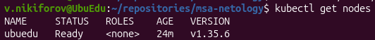
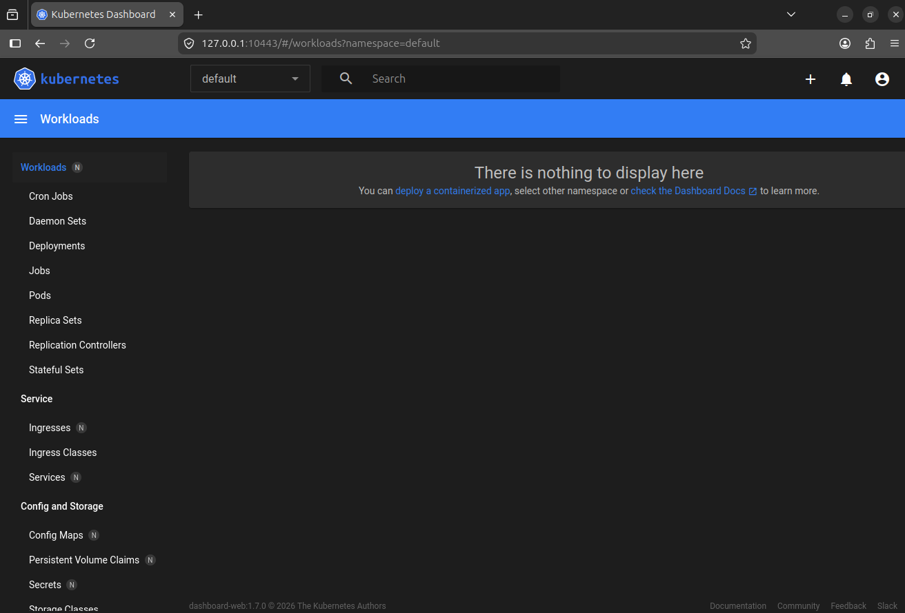

# Домашнее задание к занятию «Kubernetes. Причины появления. Команда kubectl»

## Задание 1. Установка MicroK8S

Установлен MicroK8S на локальную виртуальную машину с ОС Linux.

Установлен Kubernetes Dashboard:

```bash
microk8s enable dashboard
```

Для подключения по внешнему IP в файл `/var/snap/microk8s/current/certs/csr.conf.template` добавлен IP-адрес виртуальной машины:

```ini
IP.3 = 192.168.56.104
```

После изменения конфигурации сертификат обновлён:

```bash
sudo microk8s refresh-certs --cert server.crt
```

## Задание 2. Установка и настройка локального kubectl

Установлен `kubectl` и настроено подключение к кластеру MicroK8S.

Проверка состояния ноды:

```bash
kubectl get nodes
```



Для подключения к Kubernetes Dashboard выполнен проброс порта:

```bash
kubectl port-forward -n kubernetes-dashboard service/kubernetes-dashboard-kong-proxy 10443:443
```

Kubernetes Dashboard доступен по адресу `https://127.0.0.1:10443`.


