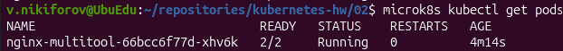
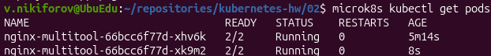
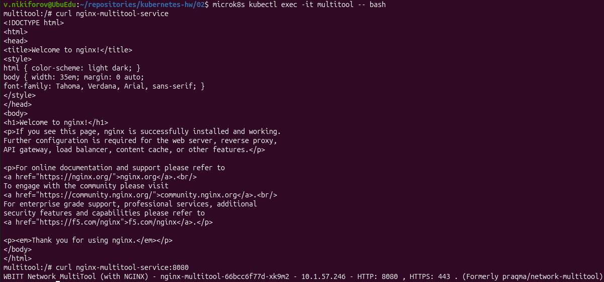
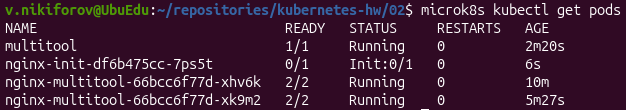
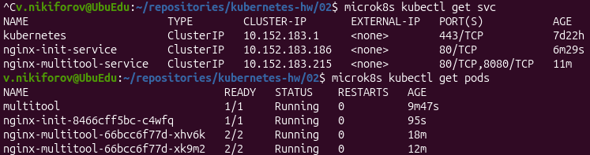

# Домашнее задание к занятию «Запуск приложений в K8S»

## Задание 1. Создать Deployment и обеспечить доступ к репликам приложения из другого Pod

### 1. Создание Deployment

Создан Deployment приложения, состоящего из двух контейнеров:

- `nginx`;
- `network-multitool`.

Контейнеры одного Pod используют общее сетевое пространство. По умолчанию nginx и multitool используют HTTP-порт `80`, из-за чего возникает конфликт портов.

Для решения конфликта HTTP-порт контейнера multitool был изменён на `8080`:

```yaml
env:
  - name: HTTP_PORT
    value: "8080"
```

Манифест Deployment: [deployment.yaml](./deployment.yaml)

После запуска Deployment создан один Pod с двумя работающими контейнерами:



---

### 2. Масштабирование Deployment

Количество реплик работающего приложения увеличено до двух:

```bash
microk8s kubectl scale deployment nginx-multitool --replicas=2
```

После масштабирования:



---

### 3. Создание Service

Для обеспечения доступа к репликам Deployment создан Service `nginx-multitool-service`.

Service предоставляет:

- порт `80` для nginx;
- порт `8080` для multitool.

Манифест Service: [service.yaml](./service.yaml)

---

### 4. Проверка доступа из отдельного Pod

Создан отдельный Pod с приложением `network-multitool`.

Манифест Pod: [multitool.yaml](./multitool.yaml)

Подключение к Pod:

```bash
microk8s kubectl exec -it multitool -- bash
```

Проверен доступ к nginx:

```bash
curl nginx-multitool-service
```

Проверен доступ к multitool:

```bash
curl nginx-multitool-service:8080
```

Оба приложения доступны через созданный Service:



---

## Задание 2. Создать Deployment и обеспечить старт основного контейнера при выполнении условий

### 1. Создание Deployment с Init-контейнером

Создан Deployment `nginx-init`, содержащий:

- Init-контейнер на базе `busybox`;
- основной контейнер `nginx`.

Init-контейнер ожидает появления Service приложения в DNS Kubernetes. Пока Init-контейнер не завершит свою работу, основной контейнер nginx не запускается.

Для проверки используется DNS-имя Service:

```text
nginx-init-service.default.svc.cluster.local
```

Манифест Deployment: [deployment-init.yaml](./deployment-init.yaml)

До создания Service Pod находится в состоянии `Init:0/1`:



---

### 2. Создание Service

Создан Service `nginx-init-service`.

Манифест Service: [service-init.yaml](./service-init.yaml)

После создания Service его DNS-имя становится доступно Init-контейнеру. Init-контейнер успешно завершает выполнение, после чего запускается основной контейнер nginx.

Итоговое состояние:



Pod `nginx-init` находится в состоянии `1/1 Running`, что подтверждает успешное завершение Init-контейнера и запуск nginx.
