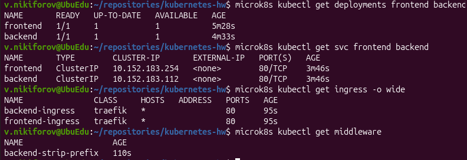
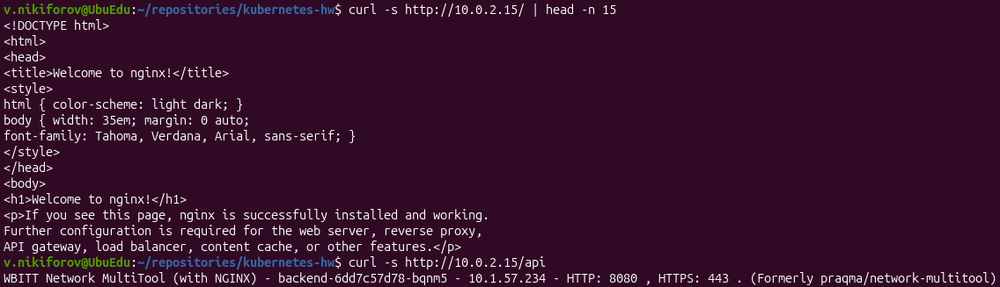

# Домашнее задание «Сетевое взаимодействие в Kubernetes»

## Окружение

- ОС: Ubuntu 26.04.1 LTS
- Kubernetes: MicroK8S v1.35.6
- Узел: `ubuedu`
- IP узла: `10.0.2.15`
- Ingress Controller: Traefik
- Namespace приложений: `default`

---

## Задание 1. Настройка Service (ClusterIP и NodePort)

### 1. Создание Deployment

Создан Deployment `nginx-multitool`, содержащий три реплики. Каждый Pod включает два контейнера:

- nginx - порт `80`.
- Network MultiTool - порт `8080`, переменная окружения `HTTP_PORT=8080`.

Манифест: [deployment-multi-container.yaml](deployment-multi-container.yaml).

Применение:

```bash
microk8s kubectl apply -f 04/deployment-multi-container.yaml
```

Проверка:

```bash
microk8s kubectl get deployments,pods -o wide
```

Результат: Deployment `nginx-multitool` имеет три доступные реплики (`3/3`). Все три Pod работают, оба контейнера в каждом Pod находятся в состоянии Ready (`2/2`).


### 2. Создание ClusterIP Service

Создан Service `nginx-multitool-clusterip`.

| Порт Service | TargetPort | Приложение |
|---|---|---|
| 9001 | 80 | nginx |
| 9002 | 8080 | multitool |

Манифест: [service-clusterip.yaml](service-clusterip.yaml).

Применение:

```bash
microk8s kubectl apply -f 04/service-clusterip.yaml
```

Проверка:

```bash
microk8s kubectl get svc nginx-multitool-clusterip
microk8s kubectl get endpointslices -l kubernetes.io/service-name=nginx-multitool-clusterip
```

Результат:

- ClusterIP: `10.152.183.235`.
- Открыты порты `9001/TCP` и `9002/TCP`.
- EndpointSlice содержит адреса трёх Pod приложения.

### 3. Проверка доступа внутри кластера

Для проверки использован отдельный Pod `multitool`.

Запрос к nginx по DNS-имени Service:

```bash
microk8s kubectl exec multitool -- curl -s http://nginx-multitool-clusterip:9001
```

Результат: получена HTML-страница `Welcome to nginx!`.

Запрос к Network MultiTool:

```bash
microk8s kubectl exec multitool -- curl -s http://nginx-multitool-clusterip:9002
```

Результат: получен ответ приложения Network MultiTool.


**Вывод:** доступ к обоим контейнерам внутри кластера через DNS-имя Service работает корректно.

### 4. Создание NodePort Service

Для доступа к nginx через IP узла создан отдельный Service `nginx-multitool-nodeport`.

Манифест: [service-nodeport.yaml](service-nodeport.yaml).

Настроены порты:

| Параметр | Значение |
|---|---|
| Service Port | 80 |
| TargetPort | 80 |
| NodePort | 30080 |
| Protocol | TCP |

Применение:

```bash
microk8s kubectl apply -f 04/service-nodeport.yaml
```

Проверка:

```bash
microk8s kubectl get svc nginx-multitool-nodeport
curl -I http://10.0.2.15:30080
```

Получен ответ:

```text
HTTP/1.1 200 OK
Server: nginx/1.31.8
Content-Type: text/html
```

Проверка выполнена с Ubuntu, на которой запущен MicroK8S.


**Вывод:** доступ к nginx через NodePort `30080` успешно настроен.

---

## Задание 2. Настройка Ingress

### 1. Создание frontend и backend

Созданы два отдельных Deployment:

| Deployment | Образ | Реплики | Порт |
|---|---|---|---|
| frontend | nginx:latest | 1 | 80 |
| backend | wbitt/network-multitool | 1 | 8080 |

Манифесты:

- [deployment-frontend.yaml](deployment-frontend.yaml)
- [deployment-backend.yaml](deployment-backend.yaml)

Применение:

```bash
microk8s kubectl apply -f 04/deployment-frontend.yaml
microk8s kubectl apply -f 04/deployment-backend.yaml
```

Проверка:

```bash
microk8s kubectl get deployments frontend backend
```

Результат: оба Deployment имеют по одной доступной реплике (`1/1`).

### 2. Создание Service

Для каждого Deployment создан отдельный ClusterIP Service.

| Service | ClusterIP | Port | TargetPort |
|---|---|---|---|
| frontend | 10.152.183.254 | 80 | 80 |
| backend | 10.152.183.112 | 80 | 8080 |

Манифесты:

- [service-frontend.yaml](service-frontend.yaml)
- [service-backend.yaml](service-backend.yaml)

Применение:

```bash
microk8s kubectl apply -f 04/service-frontend.yaml
microk8s kubectl apply -f 04/service-backend.yaml
```

Проверка:

```bash
microk8s kubectl get svc frontend backend
```

Оба Service успешно созданы и обнаружили соответствующие Pod через EndpointSlice.

### 3. Включение Ingress Controller

В MicroK8S включён Ingress:

```bash
microk8s enable ingress
```

В используемой версии MicroK8S установлен контроллер Traefik.

Проверка:

```bash
microk8s kubectl get daemonset -n ingress
microk8s kubectl get ingressclass
```

Результат:

- DaemonSet `traefik` - `1/1 Ready`.
- Зарегистрированы IngressClass `nginx`, `public`, `traefik`.
- Для маршрутизации выбран класс `traefik`.

### 4. Настройка Ingress

Созданы два Ingress-ресурса:

| Ingress | Путь | Service |
|---|---|---|
| frontend-ingress | `/` | frontend |
| backend-ingress | `/api` | backend |

Манифест: [ingress.yaml](ingress.yaml).

Для backend дополнительно настроен Traefik Middleware `StripPrefix`.

Он удаляет префикс `/api` перед передачей запроса приложению, поскольку Network MultiTool обслуживает корневой путь `/`.

Манифест: [middleware.yaml](middleware.yaml).

Применение:

```bash
microk8s kubectl apply -f 04/middleware.yaml
microk8s kubectl apply -f 04/ingress.yaml
```

Проверка:

```bash
microk8s kubectl get ingress -o wide
microk8s kubectl get middleware
```

Результат: оба Ingress созданы, Middleware зарегистрирован.



### 5. Проверка доступа через Ingress

Проверка frontend:

```bash
curl -s http://10.0.2.15/
```

Результат: HTML-страница nginx с заголовком `Welcome to nginx!`.

Проверка backend:

```bash
curl -s http://10.0.2.15/api
```

Результат: ответ Network MultiTool с информацией о контейнере backend.

Дополнительно проверены HTTP-статусы:

```bash
curl -s -o /dev/null -w "Frontend: HTTP %{http_code}\n" http://10.0.2.15/
curl -s -o /dev/null -w "Backend:  HTTP %{http_code}\n" http://10.0.2.15/api
```

Результат:

```text
Frontend: HTTP 200
Backend:  HTTP 200
```



**Вывод:** Ingress успешно маршрутизирует запросы по URL-путям `/` и `/api` к соответствующим приложениям.

---

## Проверка манифестов

Все YAML-манифесты проверены командой:

```bash
microk8s kubectl apply --dry-run=client -f 04/
```

Проверка завершилась успешно, ошибок не обнаружено.

## Итоги

В ходе выполнения домашнего задания:

1. Развёрнут Deployment с тремя репликами и двумя контейнерами в каждом Pod.
2. Настроен ClusterIP Service для доступа к nginx и multitool по разным портам.
3. Проверен доступ к контейнерам из отдельного Pod через DNS-имя Service.
4. Настроен NodePort Service для доступа к nginx через порт `30080`.
5. Развёрнуты приложения frontend и backend.
6. Включён Ingress Controller Traefik.
7. Настроена маршрутизация `/` к frontend и `/api` к backend.
8. Настроен Middleware StripPrefix для корректной обработки `/api`.
9. Проверена доступность обоих приложений через Ingress.
10. Проверена корректность YAML-манифестов.

**Оба задания успешно выполнены.**

## Файлы решения

| Файл | Назначение |
|---|---|
| [deployment-multi-container.yaml](deployment-multi-container.yaml) | Deployment с двумя контейнерами и тремя репликами |
| [service-clusterip.yaml](service-clusterip.yaml) | ClusterIP Service |
| [service-nodeport.yaml](service-nodeport.yaml) | NodePort Service |
| [deployment-frontend.yaml](deployment-frontend.yaml) | Deployment frontend |
| [deployment-backend.yaml](deployment-backend.yaml) | Deployment backend |
| [service-frontend.yaml](service-frontend.yaml) | Service frontend |
| [service-backend.yaml](service-backend.yaml) | Service backend |
| [ingress.yaml](ingress.yaml) | Ingress-маршрутизация |
| [middleware.yaml](middleware.yaml) | Traefik StripPrefix Middleware |
