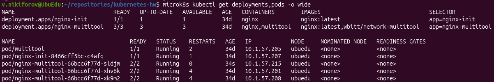
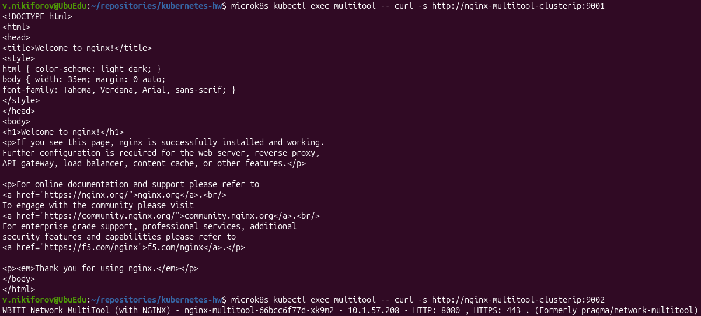
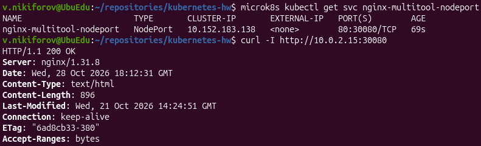

# Домашнее задание «Сетевое взаимодействие в K8S. Часть 1»

## Окружение

- ОС: Ubuntu 26.04.1 LTS
- Kubernetes: MicroK8S v1.35.6
- Узел: `ubuedu`
- IP-адрес узла: `10.0.2.15`
- Контейнеры: `nginx:latest`, `wbitt/network-multitool`

## Задание 1. Deployment и доступ к контейнерам внутри кластера

### 1. Создание Deployment

Создан Deployment `nginx-multitool`, состоящий из трёх реплик. Каждый Pod содержит два контейнера:

- `nginx` - HTTP-сервер, порт `80`.
- `multitool` - сетевой инструмент, порт `8080`.

Для контейнера multitool задана переменная окружения `HTTP_PORT=8080`.

Манифест: [01-deployment.yaml](01-deployment.yaml).

Применение:

```bash
microk8s kubectl apply -f 04/01-deployment.yaml
```

Проверка:

```bash
microk8s kubectl get deployments,pods -o wide
```

Результат: Deployment имеет три доступные реплики (`3/3`). Все три Pod находятся в состоянии `Running`, оба контейнера каждого Pod готовы (`2/2`).



### 2. Создание ClusterIP Service

Создан Service `nginx-multitool-clusterip` типа `ClusterIP` для доступа к двум контейнерам по разным портам.

| Порт Service | Целевой порт | Контейнер |
|---|---|---|
| 9001 | 80 | nginx |
| 9002 | 8080 | multitool |

Манифест: [02-clusterip.yaml](02-clusterip.yaml).

Применение:

```bash
microk8s kubectl apply -f 04/02-clusterip.yaml
```

Проверка:

```bash
microk8s kubectl get svc nginx-multitool-clusterip
microk8s kubectl get endpointslices -l kubernetes.io/service-name=nginx-multitool-clusterip
```

Результат:

- ClusterIP: `10.152.183.235`
- Порты: `9001/TCP`, `9002/TCP`
- EndpointSlice содержит адреса трёх Pod приложения.

### 3. Проверка доступа из отдельного Pod

Для проверки использован отдельный Pod `multitool`, работающий в том же namespace `default`.

Проверка доступа к nginx по DNS-имени Service:

```bash
microk8s kubectl exec multitool -- curl -s http://nginx-multitool-clusterip:9001
```

Результат: получена стандартная HTML-страница nginx с заголовком `Welcome to nginx!`.

Проверка доступа к Network MultiTool:

```bash
microk8s kubectl exec multitool -- curl -s http://nginx-multitool-clusterip:9002
```

Результат: получен HTTP-ответ приложения Network MultiTool с информацией о контейнере и сетевых параметрах.



**Вывод:** доступ к обоим контейнерам через ClusterIP Service и DNS-имя успешно проверен. Маршрутизация по портам работает корректно.

---

## Задание 2. Доступ к nginx снаружи кластера через NodePort

### 1. Создание NodePort Service

Создан отдельный Service `nginx-multitool-nodeport` типа `NodePort`.

Настроены следующие порты:

| Параметр | Значение |
|---|---|
| Service port | 80 |
| Target port | 80 |
| NodePort | 30080 |
| Протокол | TCP |

Манифест: [03-nodeport.yaml](03-nodeport.yaml).

Применение:

```bash
microk8s kubectl apply -f 04/03-nodeport.yaml
```

Проверка:

```bash
microk8s kubectl get svc nginx-multitool-nodeport
```

Результат:

```text
NAME                       TYPE       CLUSTER-IP       EXTERNAL-IP   PORT(S)
nginx-multitool-nodeport   NodePort   10.152.183.138   <none>        80:30080/TCP
```

### 2. Проверка HTTP-доступа

Проверка выполнена с Ubuntu, на которой работает MicroK8S, через IP-адрес узла Kubernetes:

```bash
curl -I http://10.0.2.15:30080
```

Получен ответ:

```text
HTTP/1.1 200 OK
Server: nginx/1.31.8
Content-Type: text/html
```

Это подтверждает доступность nginx через NodePort `30080`.



**Вывод:** NodePort Service успешно создан. Доступ к nginx через IP-адрес узла и порт `30080` работает.

---

## Итоги

В ходе выполнения домашнего задания:

1. Настроен Deployment с тремя репликами и двумя контейнерами в каждом Pod.
2. Создан ClusterIP Service для доступа к nginx и multitool по портам `9001` и `9002`.
3. Проверен доступ к обоим контейнерам из отдельного Pod с использованием `curl` и DNS-имени Service.
4. Создан NodePort Service для доступа к nginx через порт `30080`.
5. Проверена доступность nginx через IP-адрес узла Kubernetes.

Все проверки выполнены успешно.

## Файлы решения

| Файл | Назначение |
|---|---|
| [01-deployment.yaml](01-deployment.yaml) | Deployment с тремя репликами |
| [02-clusterip.yaml](02-clusterip.yaml) | Service для внутреннего доступа |
| [03-nodeport.yaml](03-nodeport.yaml) | Service для доступа через NodePort |
| [img/deployment.png](img/deployment.png) | Проверка Deployment |
| [img/clusterip-curl.png](img/clusterip-curl.png) | Проверка внутреннего доступа |
| [img/nodeport-curl.png](img/nodeport-curl.png) | Проверка NodePort |
