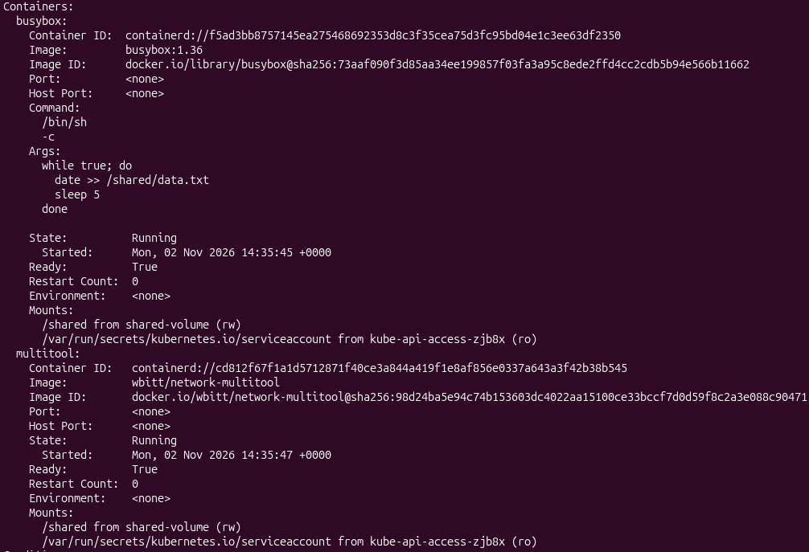
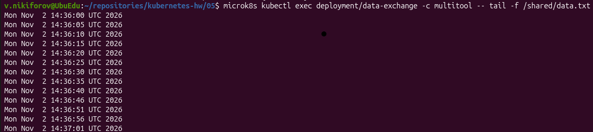
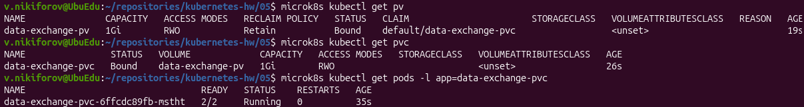
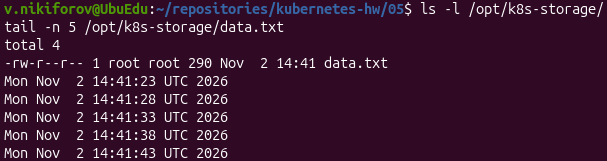
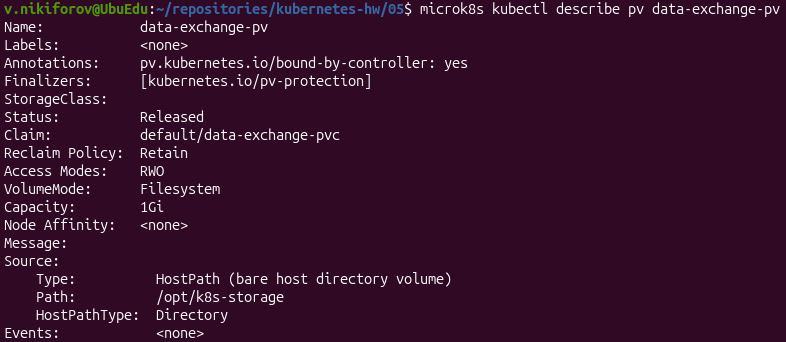
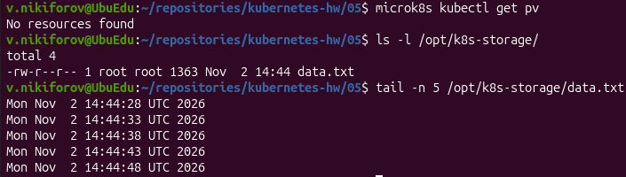
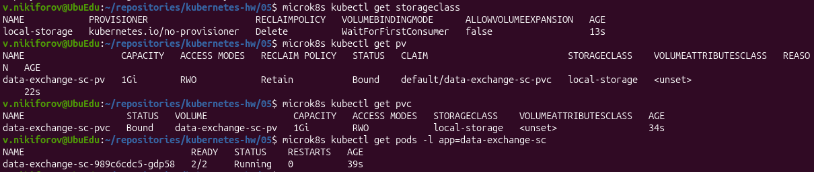
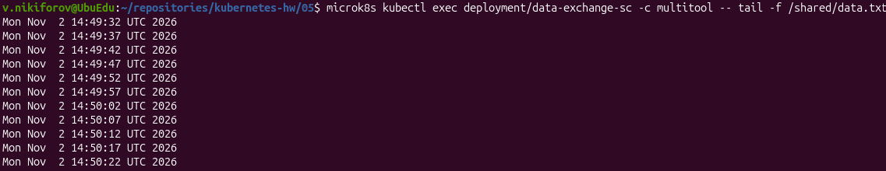
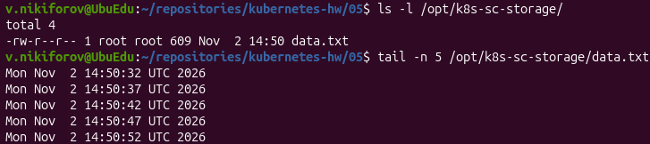

# Домашнее задание «Хранение в K8s»

## Окружение

- ОС: Ubuntu 26.04.1 LTS
- Kubernetes: MicroK8s v1.35.6
- Нода: `ubuedu`
- Container Runtime: containerd 2.1.6

## Задание 1. Volume: обмен данными между контейнерами в Pod

**Манифест:** [containers-data-exchange.yaml](containers-data-exchange.yaml)

Создан Deployment `data-exchange`, состоящий из двух контейнеров:

- `busybox` - записывает текущую дату и время в файл `/shared/data.txt` каждые 5 секунд.
- `multitool` - читает содержимое общего файла.

Для обмена данными используется том `emptyDir`, смонтированный в обоих контейнерах по пути `/shared`.

### 1. Проверка Pod

```bash
microk8s kubectl describe pods -l app=data-exchange
```

Оба контейнера находятся в состоянии `Running` и используют общий том `shared-volume`.



### 2. Проверка обмена данными

```bash
microk8s kubectl exec deployment/data-exchange -c multitool -- tail -f /shared/data.txt
```

Контейнер `multitool` успешно читает данные, которые `busybox` записывает каждые 5 секунд.



**Результат:** обмен данными между контейнерами через `emptyDir` работает.

Том `emptyDir` существует в течение жизненного цикла Pod. При удалении Pod данные из этого тома удаляются.

---

## Задание 2. PersistentVolume и PersistentVolumeClaim

**Манифест:** [pv-pvc.yaml](pv-pvc.yaml)

Созданы следующие ресурсы:

- PV: `data-exchange-pv`, объём 1Gi.
- PVC: `data-exchange-pvc`, запрос 1Gi.
- Deployment: `data-exchange-pvc`.
- Директория на ноде: `/opt/k8s-storage`.
- Политика освобождения PV: `Retain`.

Для хранения используется локальная директория ноды, подключённая через `hostPath`.

### 1. Проверка PV, PVC и Pod

```bash
microk8s kubectl get pv
microk8s kubectl get pvc
microk8s kubectl get pods -l app=data-exchange-pvc
```

PV и PVC находятся в состоянии `Bound`. Pod запущен, оба контейнера готовы (`2/2`).



### 2. Проверка чтения данных

```bash
microk8s kubectl exec deployment/data-exchange-pvc -c multitool -- tail -f /shared/data.txt
```

Контейнер `busybox` записывает данные каждые 5 секунд, а `multitool` успешно читает файл через подключённый PVC.


### 3. Проверка файла на локальной ноде

```bash
ls -l /opt/k8s-storage/
tail -n 5 /opt/k8s-storage/data.txt
```

Файл `data.txt` существует непосредственно на диске ноды и содержит данные, записанные контейнером.



### 4. Удаление Deployment и PVC

```bash
microk8s kubectl delete deployment data-exchange-pvc
microk8s kubectl delete pvc data-exchange-pvc
microk8s kubectl describe pv data-exchange-pv
```

После удаления Deployment и PVC ресурс PV перешёл из состояния `Bound` в состояние `Released`.



**Объяснение:**

При удалении PVC привязанный к нему PV освобождается. Поскольку в манифесте указана политика `persistentVolumeReclaimPolicy: Retain`, Kubernetes не удаляет PV автоматически.

PV переходит в состояние `Released` и сохраняет ссылку на предыдущий PVC (`claimRef`). Для повторного использования такого PV требуется вмешательство администратора.

Данные в директории `/opt/k8s-storage` сохраняются.

### 5. Удаление PV и проверка сохранности данных

```bash
microk8s kubectl delete pv data-exchange-pv
microk8s kubectl get pv
ls -l /opt/k8s-storage/
tail -n 5 /opt/k8s-storage/data.txt
```

После удаления PV команда `kubectl get pv` показывает `No resources found`.

При этом файл `/opt/k8s-storage/data.txt` продолжает существовать на локальной ноде, а его содержимое сохранилось.



**Объяснение:**

PV является объектом Kubernetes, описывающим хранилище.

При использовании `hostPath` удаление объекта PV не приводит к автоматическому удалению файлов из директории на хосте.

Политика `Retain` позволяет сохранить данные после освобождения PV, а удаление самого объекта PV не затрагивает содержимое локальной директории.

**Результат:** подтверждена сохранность данных после удаления Deployment, PVC и PV.

---

## Задание 3. StorageClass

**Манифест:** [sc.yaml](sc.yaml)

Созданы следующие ресурсы:

- StorageClass: `local-storage`.
- Provisioner: `kubernetes.io/no-provisioner`.
- VolumeBindingMode: `WaitForFirstConsumer`.
- PV: `data-exchange-sc-pv`, объём 1Gi.
- PVC: `data-exchange-sc-pvc`, запрос 1Gi.
- Deployment: `data-exchange-sc`.
- Директория на ноде: `/opt/k8s-sc-storage`.

Поскольку StorageClass использует `kubernetes.io/no-provisioner`, автоматическое создание PV не выполняется. Поэтому PV создан вручную.

Для PV используется тип `local` с `nodeAffinity`, указывающим на ноду `ubuedu`.

### 1. Проверка StorageClass, PV, PVC и Pod

```bash
microk8s kubectl get storageclass
microk8s kubectl get pv
microk8s kubectl get pvc
microk8s kubectl get pods -l app=data-exchange-sc
```

StorageClass создан успешно.

PV и PVC находятся в состоянии `Bound`, Pod запущен с двумя работающими контейнерами (`2/2`).



### 2. Проверка обмена данными

```bash
microk8s kubectl exec deployment/data-exchange-sc -c multitool -- tail -f /shared/data.txt
```

Контейнер `busybox` записывает текущую дату и время каждые 5 секунд.

Контейнер `multitool` успешно читает содержимое файла через PVC, связанный с StorageClass `local-storage`.



### 3. Проверка файла на локальной ноде

```bash
ls -l /opt/k8s-sc-storage/
tail -n 5 /opt/k8s-sc-storage/data.txt
```

Файл существует на локальном диске ноды, данные успешно записываются.



**Результат:** создан собственный StorageClass, настроено подключение локального PV через PVC и подтверждён обмен данными между контейнерами.

---

## Итоги

В ходе выполнения домашнего задания:

1. Настроен обмен данными между двумя контейнерами одного Pod через `emptyDir`.
2. Созданы PV и PVC для подключения локальной директории ноды.
3. Проверена политика `Retain` и сохранность данных после удаления Deployment, PVC и PV.
4. Создан собственный StorageClass с `kubernetes.io/no-provisioner`.
5. Настроено использование локального PV через PVC, связанный со StorageClass.
6. Подтверждена возможность записи и чтения данных между контейнерами во всех трёх заданиях.

Все практические задания выполнены успешно.
