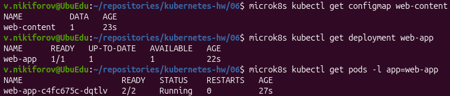
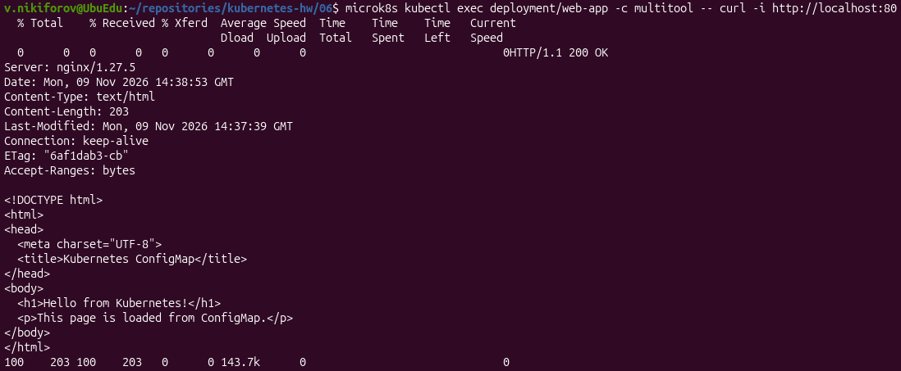
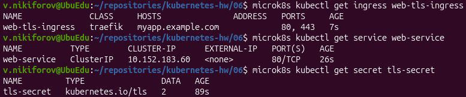
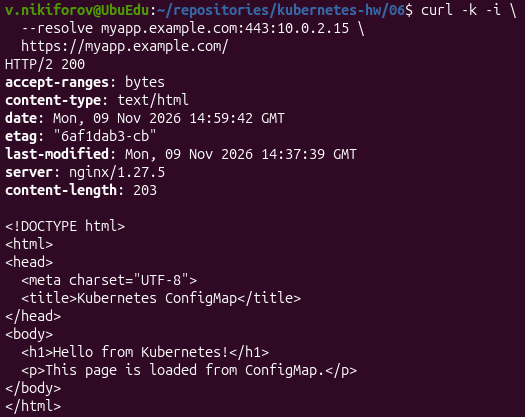
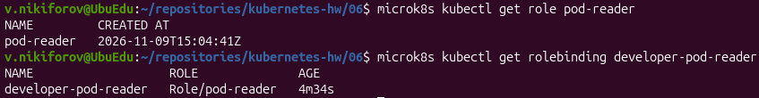
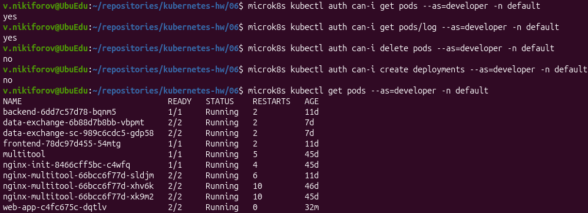
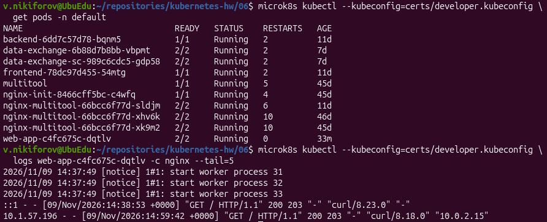

# Домашнее задание: Настройка приложений и управление доступом в Kubernetes

## Окружение

- ОС: Ubuntu
- Kubernetes: MicroK8S v1.35.6
- Узел: `ubuedu`
- Namespace: `default`
- Ingress Controller: Traefik

## Задание 1. Работа с ConfigMaps

**Цель:** развернуть приложение с двумя контейнерами nginx и multitool, подключить веб-страницу через ConfigMap.

### Манифесты

- [deployment.yaml](deployment.yaml)
- [configmap-web.yaml](configmap-web.yaml)

### Выполнение

Создан ConfigMap `web-content`, содержащий файл `index.html`.

Развёрнут Deployment `web-app` с двумя контейнерами:

- `nginx:1.27-alpine` - веб-сервер на порту 80.
- `wbitt/network-multitool:latest` - контейнер для проверки сетевого взаимодействия на порту 8080.

ConfigMap подключён к nginx через Volume по пути `/usr/share/nginx/html`.

Применение манифестов:

```bash
microk8s kubectl apply -f configmap-web.yaml
microk8s kubectl apply -f deployment.yaml
```

Проверка ресурсов:

```bash
microk8s kubectl get configmap web-content
microk8s kubectl get deployment web-app
microk8s kubectl get pods -l app=web-app
```



Проверка веб-страницы:

```bash
microk8s kubectl exec deployment/web-app -c multitool -- curl -i http://localhost:80
```



**Результат:** HTTP/1.1 200 OK. nginx успешно возвращает HTML-страницу, загруженную из ConfigMap. Оба контейнера находятся в состоянии Running.

---

## Задание 2. Настройка HTTPS с Secrets

**Цель:** настроить HTTPS-доступ к приложению через Ingress с использованием самоподписанного TLS-сертификата.

### Манифесты

- [secret-tls.example.yaml](secret-tls.example.yaml) - безопасный шаблон TLS Secret.
- [ingress-tls.yaml](ingress-tls.yaml)
- [service-web.yaml](service-web.yaml)

### Генерация сертификата

```bash
openssl req -x509 -nodes -days 365 -newkey rsa:2048 \
  -keyout tls.key \
  -out tls.crt \
  -subj "/CN=myapp.example.com" \
  -addext "subjectAltName=DNS:myapp.example.com"
```

Проверка сертификата:

```bash
openssl x509 -in tls.crt -noout -subject -dates -ext subjectAltName
```

### Создание TLS Secret

Генерация манифеста из сертификата и приватного ключа:

```bash
microk8s kubectl create secret tls tls-secret \
  --cert=tls.crt \
  --key=tls.key \
  --dry-run=client -o yaml > secret-tls.yaml
```

Применение:

```bash
microk8s kubectl apply -f secret-tls.yaml
```

Файл `secret-tls.yaml` с реальными ключами исключён из Git. В репозитории представлен шаблон.

### Настройка Service и Ingress

```bash
microk8s kubectl apply -f service-web.yaml
microk8s kubectl apply -f ingress-tls.yaml
```

Проверка ресурсов:

```bash
microk8s kubectl get ingress web-tls-ingress
microk8s kubectl get service web-service
microk8s kubectl get secret tls-secret
```



### Проверка HTTPS

```bash
curl -k -i \
  --resolve myapp.example.com:443:10.0.2.15 \
  https://myapp.example.com/
```



**Результат:** HTTP/2 200. Приложение доступно по HTTPS с самоподписанным сертификатом. Ingress направляет запросы через Service к nginx.

---

## Задание 3. Настройка RBAC

**Цель:** создать пользователя `developer` с ограниченными правами на просмотр Pod и их логов.

### Манифесты

- [role-pod-reader.yaml](role-pod-reader.yaml)
- [rolebinding-developer.yaml](rolebinding-developer.yaml)

### Включение RBAC

```bash
microk8s enable rbac
microk8s status --wait-ready
```

### Генерация сертификата пользователя

Создание приватного ключа:

```bash
openssl genrsa -out developer.key 2048
```

Создание CSR:

```bash
openssl req -new \
  -key developer.key \
  -out developer.csr \
  -subj "/CN=developer"
```

Подписание сертификата CA кластера MicroK8S:

```bash
sudo openssl x509 -req \
  -in developer.csr \
  -CA /var/snap/microk8s/current/certs/ca.crt \
  -CAkey /var/snap/microk8s/current/certs/ca.key \
  -CAcreateserial \
  -out developer.crt \
  -days 365 \
  -sha256
```

Проверка:

```bash
openssl x509 -in developer.crt -noout -subject -issuer -dates
```

Сертификат выдан пользователю `developer` и действует до 09.11.2027.

Приватные ключи и kubeconfig пользователя не публикуются в репозитории.

### Настройка Role и RoleBinding

Создана Role `pod-reader` с разрешениями:

- `get`, `list`, `watch` для ресурса `pods`.
- `get` для ресурса `pods/log`.

Создан RoleBinding `developer-pod-reader`, связывающий пользователя `developer` с ролью `pod-reader` в namespace `default`.

Применение:

```bash
microk8s kubectl apply -f role-pod-reader.yaml
microk8s kubectl apply -f rolebinding-developer.yaml
```

Проверка ресурсов:

```bash
microk8s kubectl get role pod-reader
microk8s kubectl get rolebinding developer-pod-reader
```



### Проверка разрешений

```bash
microk8s kubectl auth can-i get pods --as=developer -n default
microk8s kubectl auth can-i get pods/log --as=developer -n default
microk8s kubectl auth can-i delete pods --as=developer -n default
microk8s kubectl auth can-i create deployments --as=developer -n default
microk8s kubectl get pods --as=developer -n default
```

Полученные результаты:

| Действие | Результат |
|---|---|
| Просмотр Pod | yes |
| Чтение логов Pod | yes |
| Удаление Pod | no |
| Создание Deployment | no |
| Получение списка Pod | Успешно |



### Проверка сертификатной аутентификации

Для пользователя `developer` создан отдельный kubeconfig с клиентским сертификатом.

Проверка списка Pod:

```bash
microk8s kubectl --kubeconfig=certs/developer.kubeconfig \
  get pods -n default
```

Проверка логов nginx:

```bash
microk8s kubectl --kubeconfig=certs/developer.kubeconfig \
  logs web-app-c4fc675c-dqtlv -c nginx --tail=5
```



**Результат:** пользователь успешно аутентифицируется с помощью сертификата, просматривает Pod и читает их логи. Изменение ресурсов запрещено.

---

## Итоги

В ходе выполнения домашнего задания:

1. Развёрнуто приложение nginx + multitool с HTML-страницей из ConfigMap.
2. Настроен HTTPS через TLS Secret и Ingress Traefik.
3. Создан пользователь `developer` с сертификатной аутентификацией.
4. Настроены Role и RoleBinding для ограничения доступа к ресурсам Kubernetes.
5. Проверены разрешённые и запрещённые операции.
