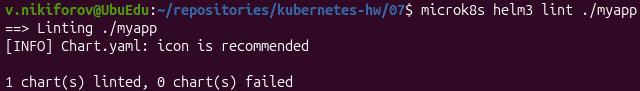
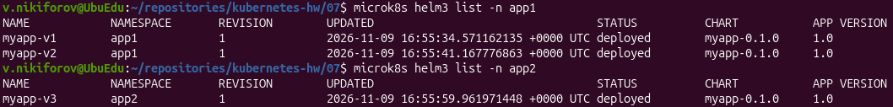
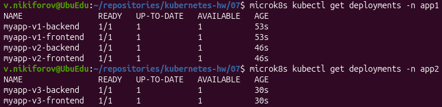
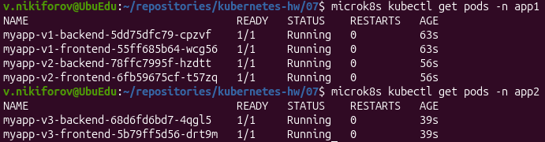
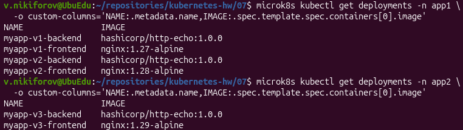
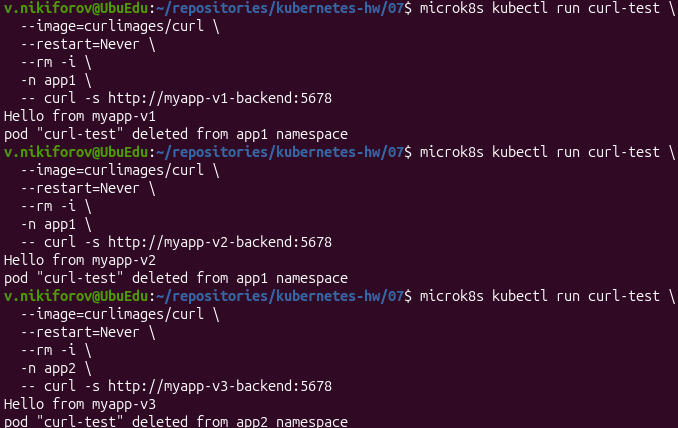

# Домашнее задание «Helm»

## Задание 1. Подготовить Helm-чарт для приложения

Для выполнения задания использовался Kubernetes-кластер MicroK8S и Helm 3.

Создан Helm-чарт `myapp`, содержащий два компонента приложения:

- **Frontend** - Nginx.
- **Backend** - HashiCorp HTTP Echo.

Каждый компонент разворачивается отдельным Deployment и имеет собственный Service.

Версии Docker-образов и количество реплик задаются через `values.yaml`.

### Структура Helm-чарта

```text
myapp/
├── Chart.yaml
├── .helmignore
├── values.yaml
└── templates/
    ├── backend-deployment.yaml
    ├── backend-service.yaml
    ├── frontend-deployment.yaml
    └── frontend-service.yaml
```

### Проверка Helm-чарта

Выполнена проверка:

```bash
microk8s helm3 lint ./myapp
```

Результат: `1 chart(s) linted, 0 chart(s) failed`.



Для проверки генерации Kubernetes-манифестов использовалась команда:

```bash
microk8s helm3 template test-release ./myapp
```

Чарт успешно генерирует два Deployment и два Service.

## Задание 2. Запустить две версии в разных namespaces

Для демонстрации работы Helm созданы два пространства имён:

```bash
microk8s kubectl create namespace app1
microk8s kubectl create namespace app2
```

Подготовлены три файла конфигурации:

- `values-v1.yaml` - Nginx 1.27.
- `values-v2.yaml` - Nginx 1.28.
- `values-v3.yaml` - Nginx 1.29.

### Установка приложений

В namespace `app1` установлены два Helm Release:

```bash
microk8s helm3 install myapp-v1 ./myapp -f values-v1.yaml -n app1
microk8s helm3 install myapp-v2 ./myapp -f values-v2.yaml -n app1
```

В namespace `app2` установлен третий Helm Release:

```bash
microk8s helm3 install myapp-v3 ./myapp -f values-v3.yaml -n app2
```

### Проверка Helm Release

```bash
microk8s helm3 list -n app1
microk8s helm3 list -n app2
```

Все три релиза находятся в статусе `deployed`.



### Проверка Deployment

```bash
microk8s kubectl get deployments -n app1
microk8s kubectl get deployments -n app2
```

Создано шесть Deployment: четыре в `app1` и два в `app2`.

Все Deployment имеют статус готовности `1/1`.



### Проверка Pod

```bash
microk8s kubectl get pods -n app1
microk8s kubectl get pods -n app2
```

Все шесть Pod находятся в статусе `Running`.



### Проверка версий Docker-образов

Для проверки образов выполнены команды:

```bash
microk8s kubectl get deployments -n app1 \
  -o custom-columns='NAME:.metadata.name,IMAGE:.spec.template.spec.containers[0].image'

microk8s kubectl get deployments -n app2 \
  -o custom-columns='NAME:.metadata.name,IMAGE:.spec.template.spec.containers[0].image'
```

Используются следующие версии:

| Helm Release | Namespace | Frontend | Backend |
|---|---|---|---|
| myapp-v1 | app1 | nginx:1.27-alpine | hashicorp/http-echo:1.0.0 |
| myapp-v2 | app1 | nginx:1.28-alpine | hashicorp/http-echo:1.0.0 |
| myapp-v3 | app2 | nginx:1.29-alpine | hashicorp/http-echo:1.0.0 |



### Проверка доступности приложений

Для проверки HTTP-ответов использовался временный Pod с образом `curlimages/curl`.

Проверка первого приложения:

```bash
microk8s kubectl run curl-test \
  --image=curlimages/curl \
  --restart=Never --rm -i -n app1 \
  -- curl -s http://myapp-v1-backend:5678
```

Ответ: `Hello from myapp-v1`.

Проверка второго приложения:

```bash
microk8s kubectl run curl-test \
  --image=curlimages/curl \
  --restart=Never --rm -i -n app1 \
  -- curl -s http://myapp-v2-backend:5678
```

Ответ: `Hello from myapp-v2`.

Проверка третьего приложения:

```bash
microk8s kubectl run curl-test \
  --image=curlimages/curl \
  --restart=Never --rm -i -n app2 \
  -- curl -s http://myapp-v3-backend:5678
```

Ответ: `Hello from myapp-v3`.



## Итог

В ходе выполнения домашнего задания:

1. Создан Helm-чарт для приложения из двух компонентов.
2. Настроена параметризация Docker-образов через `values.yaml`.
3. Проверена корректность Helm-чарта.
4. Развёрнуты три Helm Release в двух namespaces.
5. Подтверждена работа трёх версий Nginx.
6. Проверены Deployment, Pod и доступность backend-приложений по HTTP.

**Все требования домашнего задания выполнены.**
