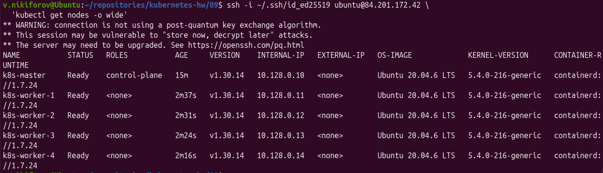

# Домашнее задание 09. Установка Kubernetes

## Задание. Установка Kubernetes с помощью kubeadm

Развёрнут Kubernetes-кластер из пяти виртуальных машин в Yandex Cloud с использованием Terraform.

### Конфигурация кластера

| Узел | Роль | CPU | RAM | Внутренний IP |
|---|---|---|---|---|
| k8s-master | Control Plane | 2 | 4 ГБ | 10.128.0.10 |
| k8s-worker-1 | Worker | 2 | 2 ГБ | 10.128.0.11 |
| k8s-worker-2 | Worker | 2 | 2 ГБ | 10.128.0.12 |
| k8s-worker-3 | Worker | 2 | 2 ГБ | 10.128.0.13 |
| k8s-worker-4 | Worker | 2 | 2 ГБ | 10.128.0.14 |

### Используемое ПО

- Ubuntu 20.04.6 LTS
- Kubernetes v1.30.14
- containerd 1.7.24
- kubeadm
- Calico v3.28.2
- Terraform
- Yandex Cloud

### Выполнение

1. С помощью Terraform созданы пять виртуальных машин в Yandex Cloud.
2. Настроены сеть и Security Group.
3. На всех узлах отключён swap.
4. Настроены модули ядра и параметры сети.
5. Установлен и настроен containerd с `SystemdCgroup = true`.
6. Установлены компоненты Kubernetes.
7. Control Plane инициализирован с помощью `kubeadm init`.
8. Установлен сетевой плагин Calico.
9. Четыре worker-узла подготовлены скриптом `prepare-workers.sh` и подключены командой `kubeadm join`.

### Проверка

Выполнена команда:

```bash
kubectl get nodes -o wide
```

Все пять узлов успешно подключены к кластеру и находятся в состоянии `Ready`.



### Файлы проекта

- `providers.tf` - настройка Terraform и провайдера Yandex Cloud.
- `main.tf` - создание виртуальных машин.
- `security.tf` - настройка Security Group.
- `prepare-workers.sh` - подготовка worker-узлов.
- `img/kubernetes-nodes.png` - подтверждение работоспособности кластера.
