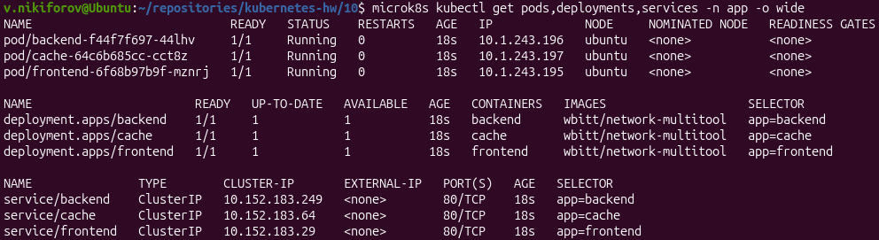
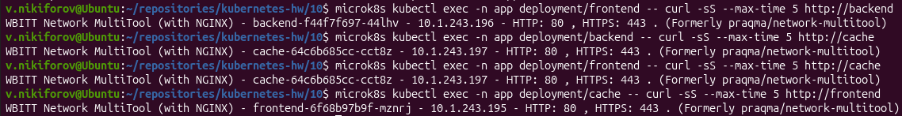
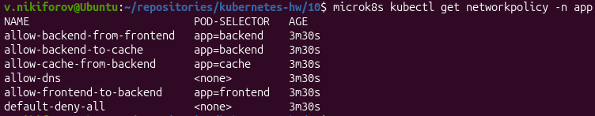
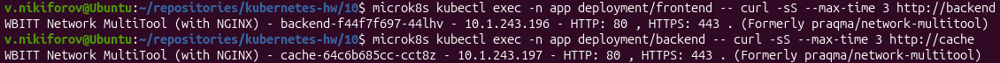
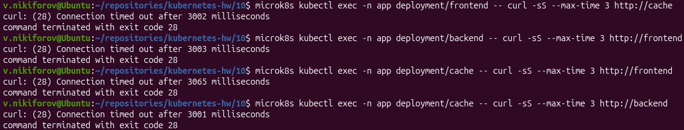

# Домашнее задание «Как работает сеть в K8s»

## Цель

Настроить сетевые политики Kubernetes для ограничения доступа между приложениями с использованием Calico.

## Окружение

- ОС: Ubuntu 26.04 LTS
- Kubernetes: MicroK8s v1.35.6
- Сетевой плагин: Calico
- Namespace: `app`
- Образ контейнеров: `wbitt/network-multitool`

## Задание 1. Настройка сетевых политик

### 1. Создание приложений

Создан namespace `app`:

```bash
microk8s kubectl create namespace app
```

Развёрнуты три Deployment и соответствующие Service:

- `frontend`
- `backend`
- `cache`

Все приложения используют образ `wbitt/network-multitool`.
Сервисы имеют тип `ClusterIP` и порт `80/TCP`.

Манифест: [applications.yaml](applications.yaml).

Применение:

```bash
microk8s kubectl apply -f applications.yaml
```

Проверка ресурсов:

```bash
microk8s kubectl get pods,deployments,services -n app -o wide
```



### 2. Проверка соединений до применения NetworkPolicy

До применения политик сетевой доступ между приложениями не ограничен.

Проверены следующие соединения:

```bash
microk8s kubectl exec -n app deployment/frontend -- curl -sS --max-time 5 http://backend
microk8s kubectl exec -n app deployment/backend -- curl -sS --max-time 5 http://cache
microk8s kubectl exec -n app deployment/frontend -- curl -sS --max-time 5 http://cache
microk8s kubectl exec -n app deployment/cache -- curl -sS --max-time 5 http://frontend
```

Все запросы выполнены успешно.



### 3. Создание NetworkPolicy

Для ограничения сетевого взаимодействия созданы следующие политики:

- `default-deny-all` - запрет входящего и исходящего трафика.
- `allow-dns` - разрешение DNS-запросов к CoreDNS.
- `allow-frontend-to-backend` - исходящий трафик frontend к backend.
- `allow-backend-from-frontend` - входящий трафик backend от frontend.
- `allow-backend-to-cache` - исходящий трафик backend к cache.
- `allow-cache-from-backend` - входящий трафик cache от backend.

Манифест: [network-policy.yaml](network-policy.yaml).

Применение:

```bash
microk8s kubectl apply -f network-policy.yaml
```

Проверка:

```bash
microk8s kubectl get networkpolicy -n app
```



### 4. Проверка разрешённых соединений

Разрешены следующие направления:

- frontend → backend
- backend → cache

Команды проверки:

```bash
microk8s kubectl exec -n app deployment/frontend -- curl -sS --max-time 3 http://backend
microk8s kubectl exec -n app deployment/backend -- curl -sS --max-time 3 http://cache
```

Оба запроса успешно возвращают HTTP-ответы.



### 5. Проверка запрещённых соединений

Проверены следующие направления:

- frontend → cache
- backend → frontend
- cache → frontend
- cache → backend

Команды проверки:

```bash
microk8s kubectl exec -n app deployment/frontend -- curl -sS --max-time 3 http://cache
microk8s kubectl exec -n app deployment/backend -- curl -sS --max-time 3 http://frontend
microk8s kubectl exec -n app deployment/cache -- curl -sS --max-time 3 http://frontend
microk8s kubectl exec -n app deployment/cache -- curl -sS --max-time 3 http://backend
```

Все запросы завершаются ошибкой:

```text
curl: (28) Connection timed out
command terminated with exit code 28
```



### 6. Итоговые результаты

| Источник | Назначение | Результат |
|---|---|---|
| frontend | backend | Разрешено |
| backend | cache | Разрешено |
| frontend | cache | Запрещено |
| backend | frontend | Запрещено |
| cache | frontend | Запрещено |
| cache | backend | Запрещено |

## Вывод

В Kubernetes развёрнуты три приложения с использованием образа `wbitt/network-multitool`.

С помощью Calico и NetworkPolicy настроена схема взаимодействия:

**frontend → backend → cache**

Другие проверенные направления соединений между приложениями заблокированы.

Разрешение DNS сохранено для корректного обращения к сервисам Kubernetes по именам.

Все требования задания выполнены.
