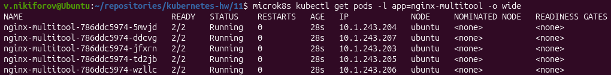
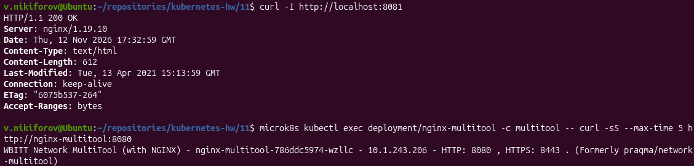
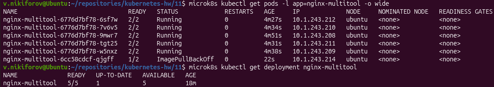
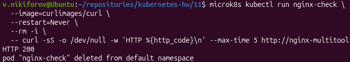
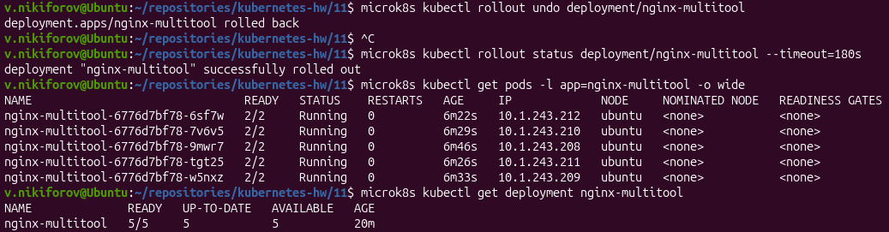
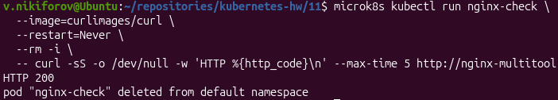

# Домашнее задание «Обновление приложений»

## Окружение

- ОС: Ubuntu 26.04 LTS
- Kubernetes: MicroK8s v1.35.6
- Контейнеры: nginx, wbitt/network-multitool
- Количество реплик: 5
- Namespace: default

## Задание 1. Выбор стратегии обновления

### Условия

- Приложение состоит из нескольких реплик.
- Ресурсы ограничены, увеличить их невозможно.
- Запас ресурсов при минимальной нагрузке составляет 20%.
- Обновление мажорное, новая версия несовместима со старой.

### Выбранная стратегия: Recreate

Для обновления приложения выбрана стратегия `Recreate`.

При использовании `RollingUpdate` старые и новые версии приложения временно работают одновременно. Поскольку версии несовместимы, это может привести к ошибкам.

Стратегия `Recreate` сначала завершает все старые Pod, после чего создаёт Pod новой версии.

Преимущества:

- Исключается одновременная работа несовместимых версий.
- Не требуется создавать дополнительные реплики сверх заданного количества.
- Стратегия подходит для ограниченных вычислительных ресурсов.

Недостатки:

- Приложение временно недоступно во время обновления.
- Необходимо предусмотреть окно обслуживания.

**Вывод:** с учётом несовместимости версий и ограниченных ресурсов наиболее подходящей является стратегия `Recreate`. Обновление следует выполнять в период минимальной нагрузки.

## Задание 2. Обновление приложения

### 1. Создание Deployment

Создан Deployment `nginx-multitool`, содержащий два контейнера:

- `nginx:1.19`
- `wbitt/network-multitool`

Количество реплик - 5.

Для исключения конфликта портов у multitool установлены переменные:

- `HTTP_PORT=8080`
- `HTTPS_PORT=8443`

nginx использует порт 80.

Манифесты:

- [deployment.yaml](deployment.yaml)
- [service.yaml](service.yaml)

Применение:

```bash
microk8s kubectl apply -f deployment.yaml
microk8s kubectl apply -f service.yaml
```

Проверка:

```bash
microk8s kubectl get pods -l app=nginx-multitool -o wide
microk8s kubectl get deployment nginx-multitool
```

Все 5 Pod успешно запущены, каждый содержит два работающих контейнера.



### 2. Проверка доступности приложения

Для доступа к nginx использован port-forward:

```bash
microk8s kubectl port-forward service/nginx-multitool 8081:80
```

Проверка:

```bash
curl -I http://localhost:8081
```

Результат:

- HTTP 200 OK
- nginx/1.19.10

Также проверена доступность multitool через Service на порту 8080.



### 3. Обновление nginx до версии 1.20

Для обновления используется стратегия RollingUpdate:

```yaml
strategy:
  type: RollingUpdate
  rollingUpdate:
    maxSurge: 1
    maxUnavailable: 0
```

`maxSurge: 1` разрешает создание одного дополнительного Pod.

`maxUnavailable: 0` не допускает планового сокращения количества доступных реплик ниже пяти.

В Deployment также настроена readinessProbe для nginx.

Обновление выполнено командой:

```bash
microk8s kubectl set image deployment/nginx-multitool nginx=nginx:1.20
```

Проверка:

```bash
microk8s kubectl rollout status deployment/nginx-multitool --timeout=180s
microk8s kubectl get deployment nginx-multitool
microk8s kubectl exec deployment/nginx-multitool -c nginx -- nginx -v
```

Результат:

- nginx обновлён до версии 1.20.2.
- Все 5 реплик находятся в состоянии Ready.
- HTTP-запрос через Service успешно выполнен.

### 4. Неудачное обновление nginx до версии 1.50

Для моделирования ошибки использована заведомо несуществующая версия nginx.

```bash
microk8s kubectl set image deployment/nginx-multitool nginx=nginx:1.50
```

Проверка:

```bash
microk8s kubectl get pods -l app=nginx-multitool -o wide
microk8s kubectl get deployment nginx-multitool
```

Результат:

- Пять Pod предыдущей версии остались Running (2/2).
- Новый Pod перешёл в состояние ImagePullBackOff (1/2).
- Deployment сохранил 5 доступных реплик.
- Обновление не завершилось успешно.



### 5. Проверка доступности при неудачном обновлении

Проверка выполнена через Kubernetes Service из отдельного Pod:

```bash
microk8s kubectl run nginx-check \
  --image=curlimages/curl \
  --restart=Never \
  --rm -i \
  -- curl -sS -o /dev/null -w 'HTTP %{http_code}\n' \
  --max-time 5 http://nginx-multitool
```

Результат:

```text
HTTP 200
```

Приложение продолжило обслуживать запросы несмотря на неудачное обновление.



### 6. Откат обновления

Для возврата к предыдущей рабочей версии выполнен откат:

```bash
microk8s kubectl rollout undo deployment/nginx-multitool
```

Проверка завершения:

```bash
microk8s kubectl rollout status deployment/nginx-multitool --timeout=180s
```

Результат:

- Откат выполнен успешно.
- Все 5 Pod находятся в состоянии Running (2/2).
- Deployment имеет 5 доступных реплик.



### 7. Проверка после отката

Проверка версии nginx:

```bash
microk8s kubectl exec deployment/nginx-multitool -c nginx -- nginx -v
```

Результат:

```text
nginx version: nginx/1.20.2
```

Проверка HTTP через Service:

```bash
microk8s kubectl run nginx-check \
  --image=curlimages/curl \
  --restart=Never \
  --rm -i \
  -- curl -sS -o /dev/null -w 'HTTP %{http_code}\n' \
  --max-time 5 http://nginx-multitool
```

Результат:

```text
HTTP 200
```



## Итог

В ходе выполнения задания:

1. Выбрана и обоснована стратегия Recreate для обновления несовместимых мажорных версий.
2. Создан Deployment с nginx 1.19 и network-multitool, 5 реплик.
3. Настроена стратегия RollingUpdate с maxSurge=1 и maxUnavailable=0.
4. Успешно выполнено обновление nginx до версии 1.20.2.
5. Смоделировано неудачное обновление до nginx 1.50.
6. Подтверждена доступность приложения при неудачном обновлении.
7. Выполнен откат к nginx 1.20.2.
8. Подтверждена доступность приложения после отката.

Все практические требования задания выполнены.
