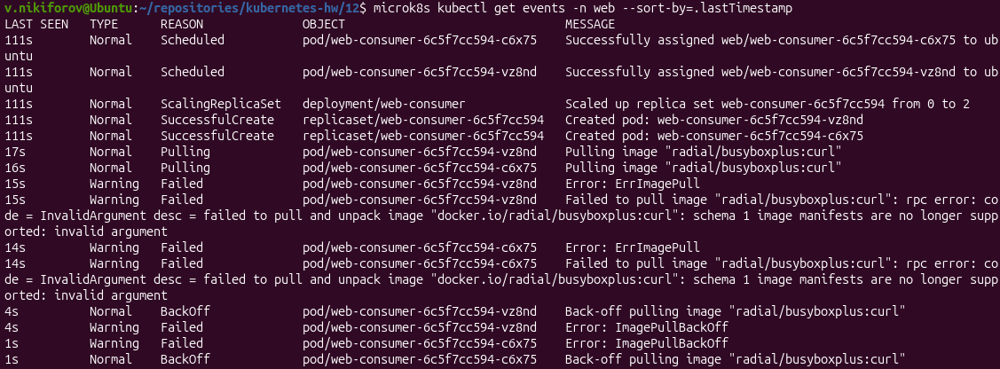
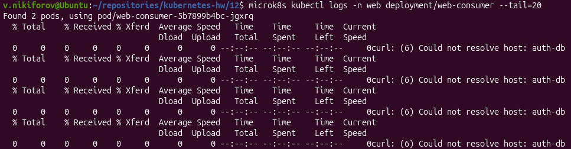
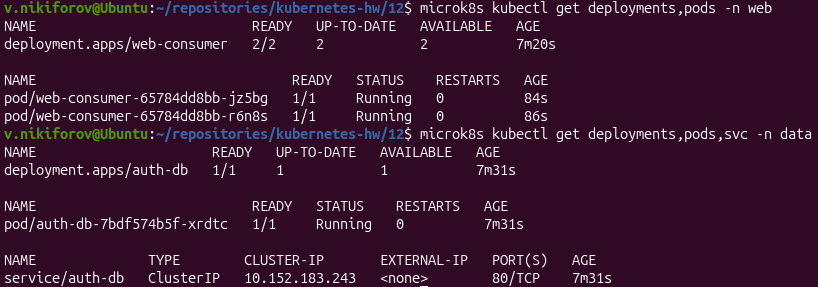

# Домашнее задание «Диагностика и устранение неисправностей в Kubernetes»

## Задание. Исправление подключения web-consumer к auth-db

### 1. Развёртывание приложения

Для выполнения задания использовался кластер Kubernetes, развёрнутый с помощью MicroK8S.

Созданы пространства имён `web` и `data`:

```bash
microk8s kubectl create namespace web
microk8s kubectl create namespace data
```

Исходный манифест получен из [репозитория Netology](https://raw.githubusercontent.com/netology-code/kuber-homeworks/main/3.5/files/task.yaml).

Приложение развёрнуто командой:

```bash
microk8s kubectl apply -f task.yaml
```

### 2. Выявленные неисправности

**Проблема № 1. Ошибка загрузки Docker-образа**

После развёртывания Pod приложения `web-consumer` находились в состоянии `ErrImagePull` и `ImagePullBackOff`.

Диагностика выполнена командой:

```bash
microk8s kubectl describe pod -n web <pod-name>
```

В событиях обнаружена ошибка:

```text
schema 1 image manifests are no longer supported: invalid argument
```

Причина: исходный образ `radial/busyboxplus:curl` использует устаревший формат Docker Image Manifest Schema 1, который не поддерживается используемой версией containerd.



**Проблема № 2. Ошибка разрешения DNS-имени**

После устранения первой неисправности контейнеры `web-consumer` успешно запустились, однако подключение к `auth-db` по-прежнему отсутствовало.

Для диагностики использовалась команда:

```bash
microk8s kubectl logs -n web deployment/web-consumer --tail=20
```

В логах обнаружена ошибка:

```text
curl: (6) Could not resolve host: auth-db
```

Причина: приложение `web-consumer` находится в namespace `web`, а Service `auth-db` - в namespace `data`. При обращении к Service из другого namespace необходимо указывать его DNS-имя с namespace.



### 3. Устранение неисправностей

**Исправление № 1. Замена Docker-образа**

Устаревший образ:

```yaml
image: radial/busyboxplus:curl
```

заменён на:

```yaml
image: curlimages/curl:8.12.1
```

**Исправление № 2. Корректировка DNS-имени**

Исходная команда:

```yaml
- while true; do curl auth-db; sleep 5; done
```

заменена на:

```yaml
- while true; do curl -sS auth-db.data.svc.cluster.local; sleep 5; done
```

Исправленный манифест: [task.yaml](task.yaml).

Изменения применены командой:

```bash
microk8s kubectl apply -f task.yaml
```

### 4. Проверка работоспособности

После применения исправлений проверено состояние ресурсов:

```bash
microk8s kubectl get deployments,pods -n web
microk8s kubectl get deployments,pods,svc -n data
```

Результат:

- `web-consumer` - 2/2 Ready.
- `auth-db` - 1/1 Ready.
- Все Pod находятся в состоянии `Running`.
- Service `auth-db` доступен на порту 80.



Для проверки подключения выполнен HTTP-запрос из контейнера `web-consumer`:

```bash
microk8s kubectl exec -n web deployment/web-consumer -- \
  curl -sS -o /dev/null -w 'HTTP %{http_code}\n' \
  http://auth-db.data.svc.cluster.local
```

Результат:

```text
HTTP 200
```

Также в логах `web-consumer` получена стандартная HTML-страница nginx с заголовком `Welcome to nginx!`.


### 5. Вывод

В ходе выполнения задания выявлены и устранены две неисправности:

1. Несовместимость устаревшего Docker-образа с используемой версией containerd.
2. Некорректное DNS-имя Service при обращении между разными пространствами имён Kubernetes.

После внесения исправлений приложение `web-consumer` успешно подключается к `auth-db`. Работоспособность подтверждена состоянием ресурсов Kubernetes и HTTP-ответом `200 OK`.
