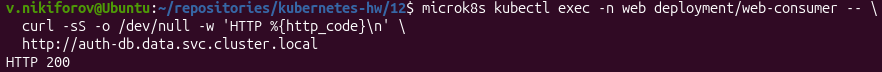

# Домашнее задание «Диагностика и устранение неисправностей в Kubernetes»

## Задание. Исправление подключения web-consumer к auth-db

### 1. Развёртывание приложения

Для выполнения задания использовался кластер Kubernetes, развёрнутый с помощью MicroK8S.

Созданы пространства имён `web` и `data`:

```bash
microk8s kubectl create namespace web
microk8s kubectl create namespace data
```

Исходный манифест получен из [репозитория Netology](https://raw.githubusercontent.com/netology-code/kuber-homeworks/main/3.5/files/task.yaml).

Приложение развёрнуто командой:

```bash
microk8s kubectl apply -f task.yaml
```

В результате созданы следующие ресурсы:

- Deployment `web-consumer` в namespace `web` - 2 реплики.
- Deployment `auth-db` в namespace `data` - 1 реплика.
- Service `auth-db` в namespace `data` - ClusterIP, порт 80.

### 2. Выявленные неисправности

**Проблема № 1. Ошибка загрузки Docker-образа**

После применения исходного манифеста оба Pod приложения `web-consumer` находились в состоянии `ErrImagePull`, а затем `ImagePullBackOff`.

Для диагностики использовалась команда:

```bash
microk8s kubectl get events -n web --sort-by=.lastTimestamp
```

В событиях Kubernetes обнаружено сообщение:

```text
Failed to pull image "radial/busyboxplus:curl": rpc error: code = InvalidArgument desc = failed to pull and unpack image "docker.io/radial/busyboxplus:curl": schema 1 image manifests are no longer supported: invalid argument
```

Причина неисправности - Docker-образ `radial/busyboxplus:curl` использует устаревший формат манифеста Schema 1, который больше не поддерживается используемой версией containerd.


**Проблема № 2. Ошибка разрешения DNS-имени**

После замены устаревшего образа контейнеры `web-consumer` успешно запустились, однако подключение к `auth-db` по-прежнему отсутствовало.

Для диагностики использовалась команда:

```bash
microk8s kubectl logs -n web deployment/web-consumer --tail=20
```

В логах обнаружена ошибка:

```text
curl: (6) Could not resolve host: auth-db
```

Причина: приложение `web-consumer` находится в namespace `web`, а Service `auth-db` - в namespace `data`.

При обращении к Service из другого namespace необходимо указывать DNS-имя с namespace, например `auth-db.data.svc.cluster.local`.


### 3. Устранение неисправностей

**Исправление № 1. Замена Docker-образа**

В манифесте `task.yaml` устаревший образ:

```yaml
image: radial/busyboxplus:curl
```

заменён на:

```yaml
image: curlimages/curl:8.12.1
```

После применения изменений контейнеры `web-consumer` успешно запустились.

**Исправление № 2. Корректировка DNS-имени**

Исходная команда контейнера:

```yaml
- while true; do curl auth-db; sleep 5; done
```

заменена на:

```yaml
- while true; do curl auth-db.data.svc.cluster.local; sleep 5; done
```

В исходном манифесте приложение `web-consumer` обращалось к Service `auth-db` по короткому имени, хотя сервис расположен в другом namespace.

Для устранения ошибки DNS-имя изменено на `auth-db.data.svc.cluster.local`, что позволяет обращаться к Service в namespace `data`.

Исправленный манифест: [task.yaml](task.yaml).

Изменения применены командой:

```bash
microk8s kubectl apply -f task.yaml
```

### 4. Проверка работоспособности

После применения исправлений проверено состояние ресурсов Kubernetes:

```bash
microk8s kubectl get deployments,pods -n web
microk8s kubectl get deployments,pods,svc -n data
```

Результат проверки:

- Deployment `web-consumer` - 2/2 Ready.
- Deployment `auth-db` - 1/1 Ready.
- Все три Pod находятся в состоянии `Running`.
- Service `auth-db` имеет тип ClusterIP и доступен на порту 80.


Для проверки подключения выполнен HTTP-запрос непосредственно из контейнера `web-consumer`:

```bash
microk8s kubectl exec -n web deployment/web-consumer -- \
  curl -sS -o /dev/null -w 'HTTP %{http_code}\n' \
  http://auth-db.data.svc.cluster.local
```

Результат:

```text
HTTP 200
```

Полученный ответ подтверждает успешное подключение приложения `web-consumer` к Service `auth-db`.



Дополнительно проверены логи приложения:

```bash
microk8s kubectl logs -n web deployment/web-consumer --tail=30
```

В логах получена стандартная HTML-страница nginx с заголовком:

```html
<h1>Welcome to nginx!</h1>
```

Это подтверждает, что приложение `web-consumer` успешно получает HTTP-ответ от `auth-db`.

### 5. Вывод

В ходе выполнения задания выявлены и устранены две неисправности:

1. **Несовместимость Docker-образа:** устаревший образ `radial/busyboxplus:curl` использовал неподдерживаемый формат манифеста Schema 1. Проблема устранена заменой образа на `curlimages/curl:8.12.1`.
2. **Ошибка DNS:** приложение `web-consumer` обращалось к Service `auth-db` по короткому имени, несмотря на размещение ресурсов в разных namespaces. Проблема устранена использованием DNS-имени `auth-db.data.svc.cluster.local`.

После внесения исправлений все компоненты приложения находятся в состоянии `Running`, а подключение `web-consumer` к `auth-db` успешно выполняется.

**Работоспособность подтверждена HTTP-ответом `200 OK`.**
